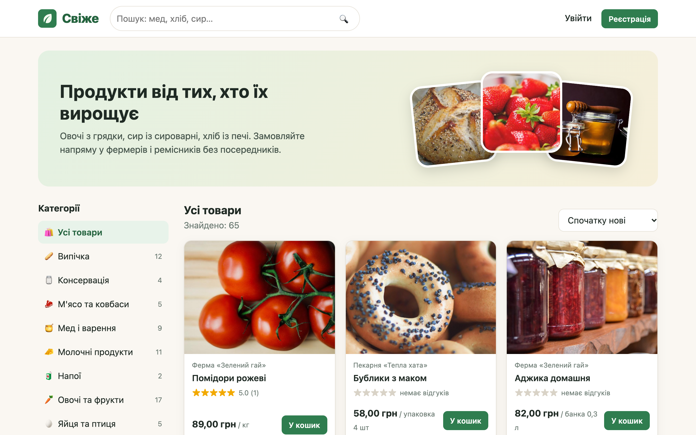

# Свіже — маркетплейс локальних продуктів

Майданчик, на якому фермери, сироварні, пекарні та пасіки продають продукти напряму покупцям.
Покупець збирає кошик у кількох магазинах одразу, а система сама ділить його на замовлення для кожного продавця.



## Можливості

| Роль | Що вміє |
|---|---|
| **Покупець** | каталог з пошуком, фільтрами та сортуванням; картка товару з відгуками; кошик; оформлення замовлення; історія та скасування замовлень; відгуки на отримані товари |
| **Продавець** | власний магазин; додавання, редагування й приховування товарів із фото; обробка замовлень за статусами; зведення по виручці |
| **Адміністратор** | схвалення нових продавців; блокування користувачів; керування категоріями; загальна статистика майданчика |

## Швидкий запуск

Потрібен лише [Docker](https://docs.docker.com/get-docker/) з Docker Compose.

```bash
git clone <адреса репозиторію> svizhe-marketplace
cd svizhe-marketplace
cp .env.example .env
docker compose up -d --build
```

Через хвилину сайт доступний на <http://localhost:8088>.
Під час першого запуску база створюється автоматично й заповнюється демонстраційними даними: 6 магазинів, 68 товарів із фото, замовлення та відгуки.
Фото товарів мають вільні ліцензії; автори та джерела — у [backend/seed-images/CREDITS.md](backend/seed-images/CREDITS.md).

### Демонстраційні акаунти

Пароль для всіх: `demo1234`

| Роль | Email |
|---|---|
| Покупець | `buyer@svizhe.ua` |
| Продавець (схвалений) | `pasika@svizhe.ua` |
| Продавець (очікує схвалення) | `sady@svizhe.ua` |
| Адміністратор | `admin@svizhe.ua` |

> Перед реальним використанням змініть паролі в `.env` і вимкніть демо-дані (`SEED_ON_START=false`) — див. [інструкцію зі встановлення](docs/INSTALL.md).

## З чого складається

Продукт має три частини, кожна працює в окремому контейнері:

| Частина | Каталог | Технології |
|---|---|---|
| Інтерфейс | [`frontend/`](frontend) | React 19, React Router, Vite; у продакшені віддається через nginx |
| Системна частина | [`backend/`](backend) | Node.js 22, Express 5, JWT-авторизація |
| База даних | [`db/`](db) | PostgreSQL 16, SQL-міграції |

```
Браузер ──► nginx (інтерфейс, порт 8088) ──/api, /uploads──► API (Express) ──► PostgreSQL
```

## Документація

| Документ | Для кого |
|---|---|
| [Встановлення та запуск](docs/INSTALL.md) | той, хто розгортає систему на сервері |
| [Посібник користувача](docs/USER_GUIDE.md) | покупці, продавці, адміністратор майданчика |
| [Посібник адміністратора системи](docs/ADMIN_GUIDE.md) | той, хто підтримує сервер: копії, оновлення, несправності |
| [Архітектура](docs/ARCHITECTURE.md) | розробники: структура коду, схема бази, логіка замовлень |
| Довідник API | відкривається на працюючому сайті: <http://localhost:8088/api/docs> |

## Тести

39 інтеграційних тестів перевіряють API на справжній базі (створюється окрема тестова база, після прогону видаляється):

```bash
docker compose exec backend npm test
```

## Структура репозиторію

```
├── backend/              системна частина (REST API)
│   ├── src/              код: маршрути, авторизація, логіка замовлень, міграції
│   ├── test/             інтеграційні тести
│   └── openapi.yaml      опис API
├── frontend/             інтерфейс (React)
│   └── src/              сторінки, компоненти, стилі
├── db/migrations/        SQL-міграції схеми бази
├── scripts/              резервне копіювання та відновлення
├── docs/                 документація та знімки екрана
├── report/               звіт (джерело в Markdown, DOCX, PDF)
├── presentation/         презентація (PPTX, PDF)
└── docker-compose.yml    запуск усіх трьох частин
```

## Автори

- Макаренко Марина Володимирівна, ІПС-41 — системна частина, база даних
- Полежай Іванна Олександрівна, ІПС-42 — інтерфейс, посібник користувача
