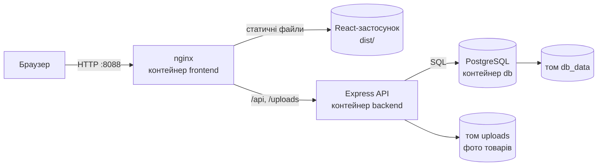
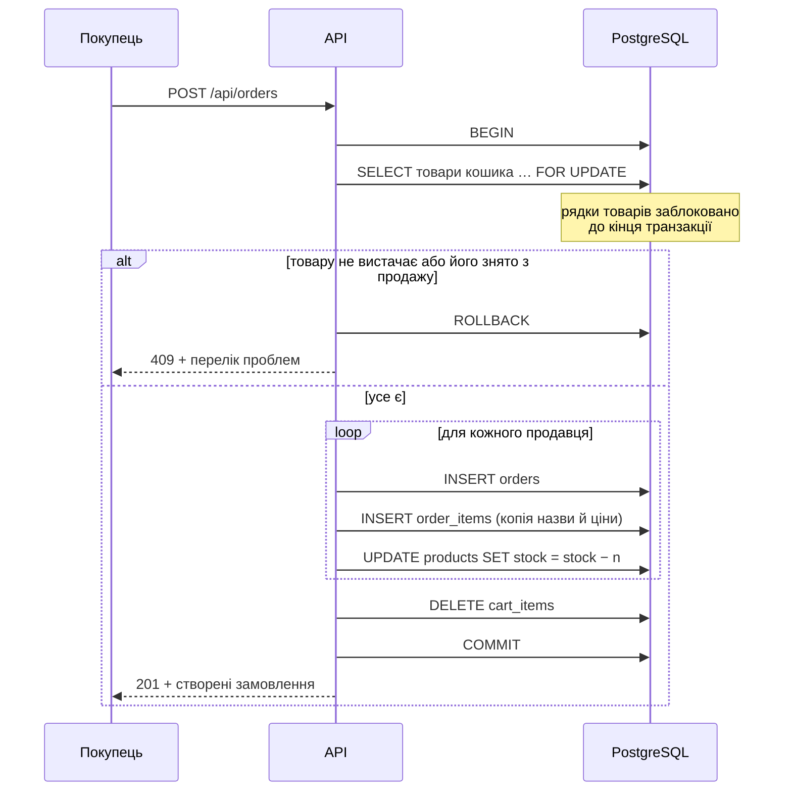
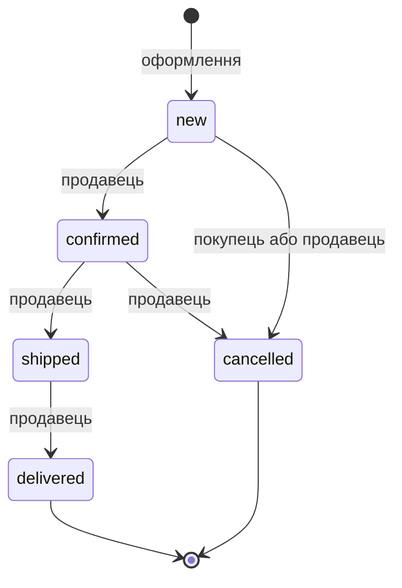

# Архітектура

Документ для розробника, який уперше відкриває код і має швидко зрозуміти, де що лежить і чому.

## Загальна схема



Назовні відкрито один порт — nginx. Базу та API з мережі напряму не видно.

## Інтерфейс (`frontend/`)

Односторінковий застосунок на React. Збирається Vite у статичні файли, які віддає nginx.

| Файл | Призначення |
|---|---|
| `src/main.jsx`, `src/App.jsx` | точка входу, таблиця маршрутів, захист сторінок за роллю (`Only`) |
| `src/api.js` | єдина функція `api()` для всіх запитів: додає токен, розбирає помилки |
| `src/context.jsx` | спільний стан: поточний користувач, лічильник кошика, сповіщення; хук `useLoad` |
| `src/components/` | оболонка сайту, картка товару, картка замовлення, дрібні елементи (`ui.jsx`) |
| `src/pages/` | по одному файлу на сторінку; кабінети продавця й адміністратора — з вкладками |
| `src/styles.css` | усе оформлення; кольори задані змінними у `:root` |
| `nginx.conf` | роздача статики та проксі `/api`, `/uploads` на backend |

Рішення, які варто знати:

- **Токен входу** зберігається в `localStorage` і передається в заголовку `Authorization: Bearer …`.
- **Фільтри каталогу живуть в адресі сторінки** (`/?category=med-varennia&sort=price_asc`), а не в стані компонента — тому працюють «Назад» і посилання.
- **Інтерфейс не вирішує питань доступу.** Він лише ховає зайві кнопки; кожну дію перевіряє API.

## Системна частина (`backend/`)

REST API на Express 5. Формат обміну — JSON. Повний перелік маршрутів — `openapi.yaml`, у працюючій системі відкривається на `/api/docs`.

| Файл | Призначення |
|---|---|
| `src/index.js` | запуск: міграції → демо-дані → HTTP-сервер; коректне завершення за SIGTERM |
| `src/app.js` | збирання застосунку: журнал запитів, маршрути, єдиний обробник помилок |
| `src/config.js` | усі налаштування зі змінних оточення |
| `src/db.js` | пул з'єднань, `query()`, `transaction()` |
| `src/migrate.js` | застосування SQL-міграцій з обліком у `schema_migrations` |
| `src/middleware/auth.js` | перевірка токена, завантаження користувача, `requireRole()` |
| `src/validate.js`, `src/errors.js` | перевірка вхідних даних, помилки з HTTP-кодами |
| `src/orders-service.js` | **основна бізнес-логіка**: оформлення, зміна статусів, повернення на склад |
| `src/routes/*.js` | маршрути за розділами: `auth`, `catalog`, `cart`, `orders`, `seller`, `admin` |
| `src/seed.js` | демо-дані |
| `test/api.test.js` | 39 інтеграційних тестів |

### Авторизація та ролі

1. Під час входу пароль порівнюється з bcrypt-хешем; у відповідь видається JWT з ідентифікатором користувача.
2. На кожен захищений запит `requireAuth` перевіряє підпис токена і **читає користувача з бази**.
   Тому зміна ролі чи блокування діють негайно, а не після завершення терміну токена.
3. `requireRole('seller')` тощо обмежує цілі групи маршрутів.
4. Продавець працює лише зі своїми даними: кожен запит у `routes/seller.js` містить умову `seller_id = <магазин поточного користувача>`. Чужий товар чи замовлення повертає 404.

### Оформлення замовлення

Функція `checkout()` в `orders-service.js` виконується однією транзакцією:



- `FOR UPDATE` блокує рядки товарів, тому двоє покупців не можуть одночасно купити останню одиницю: другий чекає завершення першої транзакції і бачить уже оновлений залишок. Це перевіряє тест «останню одиницю товару не можуть купити двоє одночасно».
- Товари блокуються в порядку `id` — це виключає взаємне блокування двох одночасних оформлень.
- Кошик ділиться на замовлення за продавцями: кожен продавець бачить і обробляє лише свою частину.

### Статуси замовлення



Дозволені переходи описані таблицею `TRANSITIONS`; будь-який інший перехід повертає 409. Під час скасування залишки повертаються на склад у тій самій транзакції.

### Помилки

Усі помилки мають однаковий вигляд: `{ "error": "текст для користувача", "details": [...] }`.

| Код | Коли |
|---|---|
| 400 | некоректні вхідні дані |
| 401 | немає токена або він недійсний |
| 403 | недостатньо прав, акаунт заблоковано |
| 404 | об'єкт не знайдено або він чужий |
| 409 | конфлікт стану: зайнятий email, немає на складі, заборонений перехід статусу |
| 500 | внутрішня помилка; подробиці — лише в журналі сервера |

## База даних (`db/`)

PostgreSQL 16. Схема описана SQL-міграціями в `db/migrations/`, які застосовуються автоматично.

```mermaid
erDiagram
    users ||--o| sellers : "має магазин"
    users ||--o{ cart_items : "кошик"
    users ||--o{ orders : "оформлює"
    users ||--o{ reviews : "пише"
    sellers ||--o{ products : "продає"
    sellers ||--o{ orders : "виконує"
    categories ||--o{ products : "містить"
    products ||--o{ cart_items : ""
    products ||--o{ order_items : ""
    products ||--o{ reviews : ""
    orders ||--|{ order_items : "складається з"

    users { serial id PK
            varchar email UK
            varchar password_hash
            varchar full_name
            varchar phone
            varchar role "buyer / seller / admin"
            boolean is_blocked
            timestamptz created_at }
    sellers { serial id PK
              int user_id FK,UK
              varchar shop_name UK
              text description
              varchar city
              varchar status "pending / approved / rejected" }
    categories { serial id PK
                 varchar name UK
                 varchar slug UK
                 varchar icon }
    products { serial id PK
               int seller_id FK
               int category_id FK
               varchar name
               text description
               numeric price "> 0"
               varchar unit
               int stock ">= 0"
               varchar image_url
               boolean is_active }
    cart_items { int user_id PK,FK
                 int product_id PK,FK
                 int quantity "> 0" }
    orders { serial id PK
             int buyer_id FK
             int seller_id FK
             varchar status
             numeric total
             varchar delivery_address
             varchar phone
             text comment }
    order_items { serial id PK
                  int order_id FK
                  int product_id FK "NULL, якщо товар видалено"
                  varchar product_name
                  numeric price
                  int quantity }
    reviews { serial id PK
              int product_id FK
              int user_id FK
              smallint rating "1..5"
              text comment }
```



Рішення, які варто знати:

- **Обмеження в самій базі.** `CHECK (price > 0)`, `CHECK (stock >= 0)`, `CHECK (rating BETWEEN 1 AND 5)`, переліки ролей і статусів, унікальність email та назви магазину. Навіть якщо в коді API буде помилка, некоректні дані в базу не потраплять.
- **`order_items` зберігає копію назви й ціни.** Історія замовлень не змінюється, коли продавець редагує або видаляє товар (`product_id` стає `NULL`).
- **Подання `catalog_products`** — єдине місце, де визначено, що таке «товар у каталозі»: активний, продавця схвалено, власника не заблоковано. Каталог, пошук, кошик і лічильники категорій читають лише з нього.
- **Індекси** (`002_indexes.sql`) покривають фільтр за категорією, історію замовлень покупця й продавця, пошук за назвою.

### Як змінити схему

1. Створіть файл `db/migrations/004_<що_змінюється>.sql` із потрібними `ALTER TABLE …`.
2. Перезапустіть системну частину: `docker compose restart backend` — міграція застосується сама.

Уже застосовані файли не редагуйте: зміни в них не виконаються повторно.

## Локальна розробка без перезбирання контейнерів

```bash
# лише база, з портом 5433 на localhost
docker compose -f docker-compose.yml -f docker-compose.dev.yml up -d db

cd backend && npm install && npm run dev     # API на :3000, перезапускається при змінах
cd frontend && npm install && npm run dev    # інтерфейс на :5173 з гарячим оновленням
npm test                                     # у каталозі backend
```
