# Посібник користувача

Сайт має три ролі. Перейдіть до розділу своєї ролі:
[покупець](#покупець) · [продавець](#продавець) · [адміністратор майданчика](#адміністратор-майданчика)

---

## Покупець

### Пошук товарів

На головній сторінці — каталог усіх товарів.

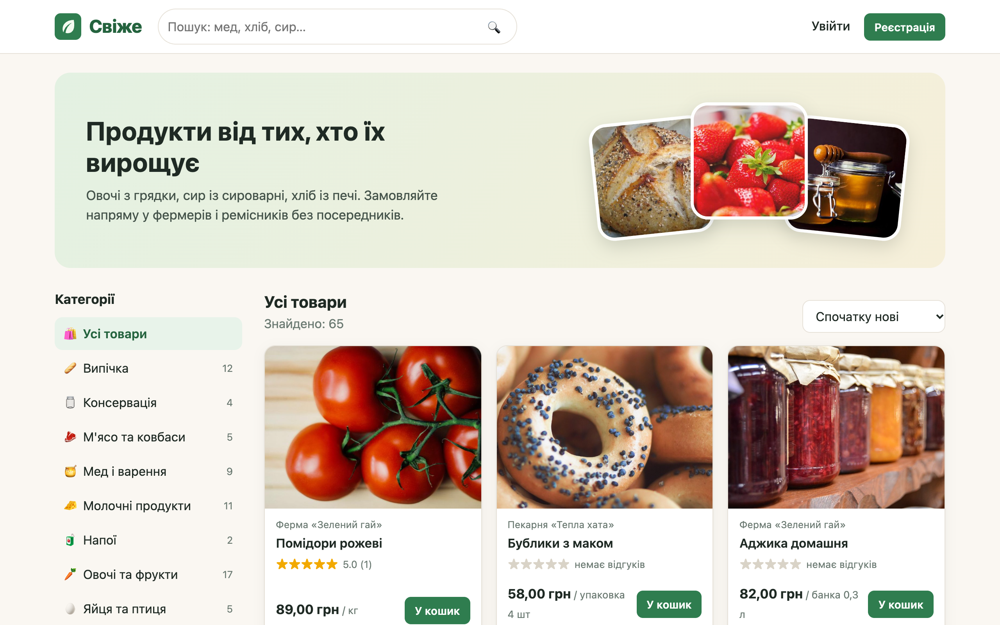

- **Пошук** у верхньому рядку шукає за назвою товару.
- **Категорії** ліворуч звужують список; число поруч показує, скільки товарів у категорії.
- **«Лише в наявності»** ховає товари, які закінчилися.
- **Сортування** праворуч: нові, дешевші, дорожчі, за рейтингом.
- **«Скинути фільтри»** повертає повний каталог.

Адреса сторінки змінюється разом із фільтрами, тому посиланням на знайдене можна поділитися.

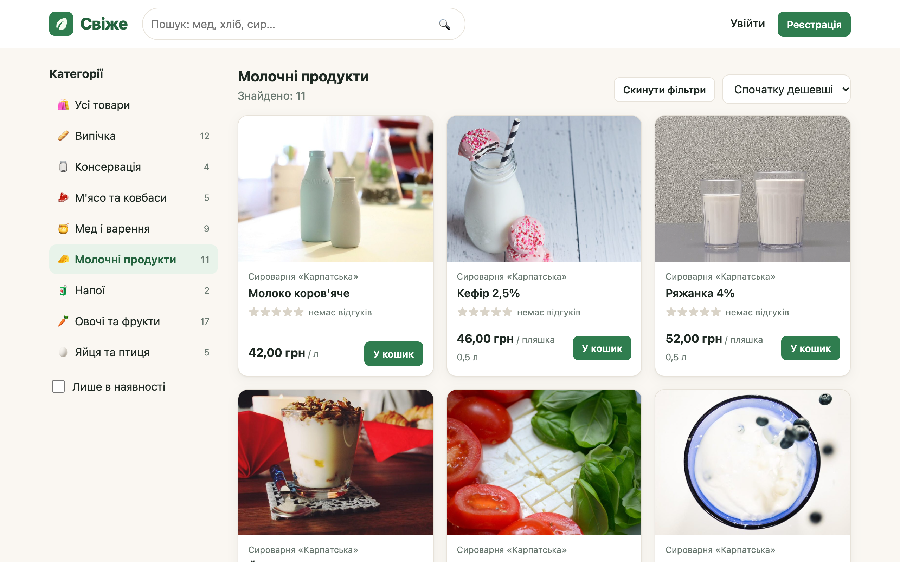

Переглядати каталог можна без реєстрації. Щоб купувати, потрібен акаунт.

### Реєстрація та вхід

1. Натисніть **«Реєстрація»** у правому верхньому куті.
2. Залиште обраним **«Я покупець»**.
3. Вкажіть ім'я, email і пароль (щонайменше 6 символів). Телефон необов'язковий — він підставиться під час оформлення замовлення.
4. Натисніть **«Зареєструватися»** — ви одразу увійдете в акаунт.

Наступного разу використовуйте **«Увійти»**. Вхід зберігається на 7 днів.

### Сторінка товару

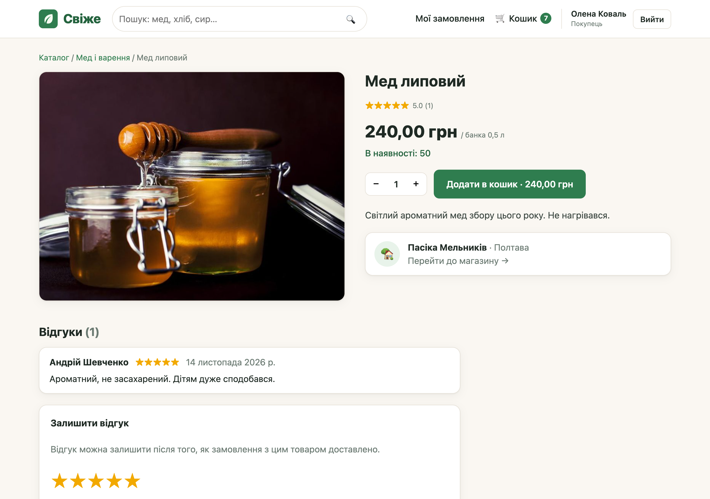

Тут видно ціну за одиницю, залишок на складі, опис, продавця та відгуки.
Кнопками **− / +** оберіть кількість і натисніть **«Додати в кошик»**.
Натиснувши на картку продавця, ви відкриєте його магазин з усіма товарами.

### Кошик

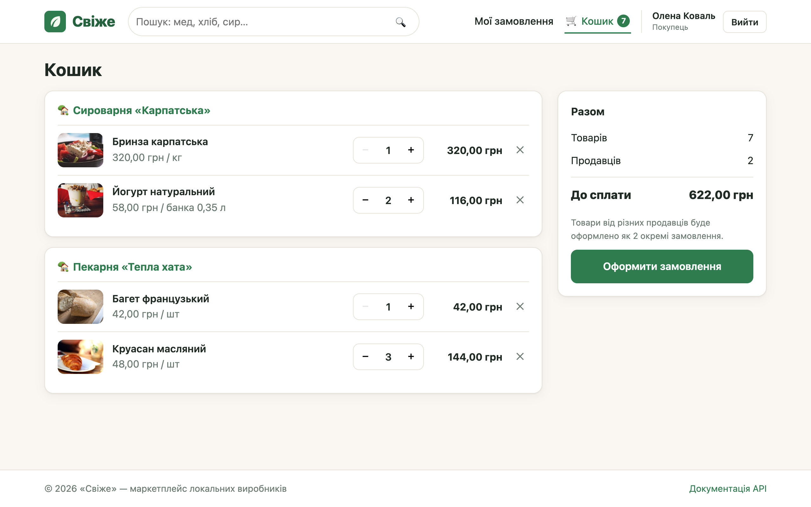

- Товари згруповані за продавцями.
- Кількість змінюється кнопками **− / +**, хрестик прибирає товар.
- Покласти більше, ніж є на складі, не вдасться — сайт покаже, скільки залишилось.
- Якщо товар зняли з продажу, поки він лежав у кошику, позиція буде позначена червоним; приберіть її, щоб продовжити.

> Товари від різних продавців оформлюються як окремі замовлення — кожен продавець доставляє своє.

### Оформлення замовлення

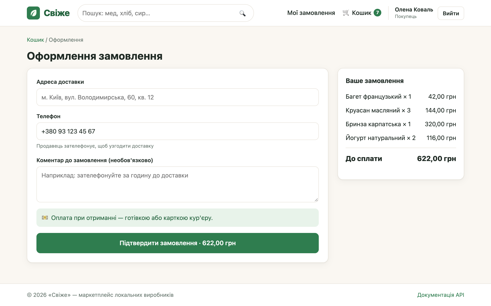

1. У кошику натисніть **«Оформити замовлення»**.
2. Вкажіть адресу доставки й телефон. Коментар — за бажанням.
3. Натисніть **«Підтвердити замовлення»**.

Оплата — при отриманні. Якщо за час оформлення хтось викупив останні одиниці товару, сайт повідомить, чого саме не вистачає, і замовлення не буде створено.

### Мої замовлення

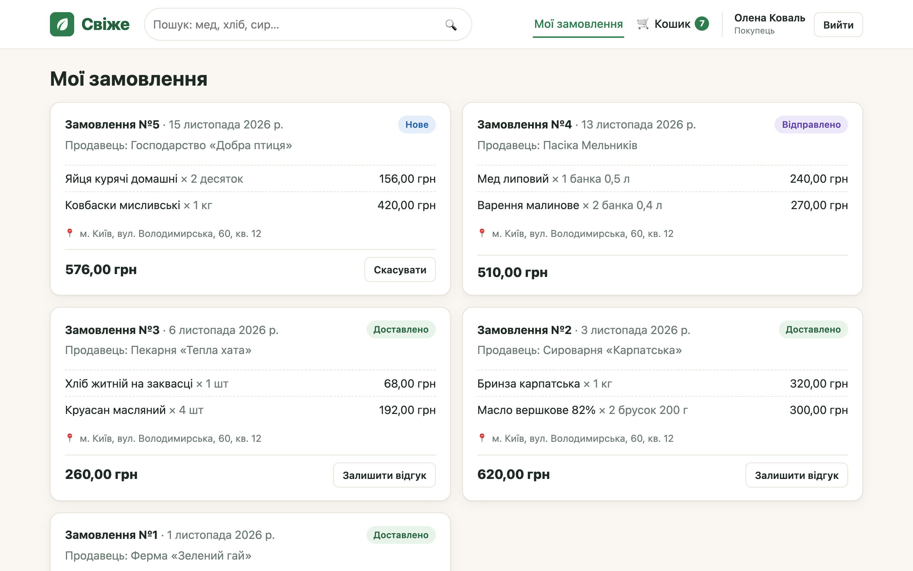

Статуси замовлення:

| Статус | Що означає | Що можна зробити |
|---|---|---|
| **Нове** | продавець ще не бачив замовлення | скасувати |
| **Підтверджено** | продавець прийняв замовлення і готує його | — |
| **Відправлено** | замовлення в дорозі | — |
| **Доставлено** | замовлення отримано | залишити відгук |
| **Скасовано** | скасували ви або продавець | — |

Скасувати самостійно можна лише **нове** замовлення. Якщо продавець уже підтвердив — зателефонуйте йому.

### Відгуки

Відгук можна залишити на товар із замовлення зі статусом **«Доставлено»**: відкрийте сторінку товару (кнопка «Залишити відгук» у замовленні), оберіть оцінку від 1 до 5 зірок і напишіть коментар. На один товар — один відгук.

### На телефоні

Сайт підлаштовується під вузький екран: категорії стають горизонтальною стрічкою, товари — у дві колонки.

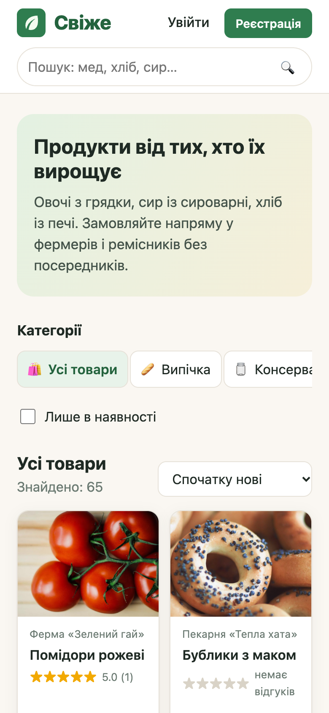 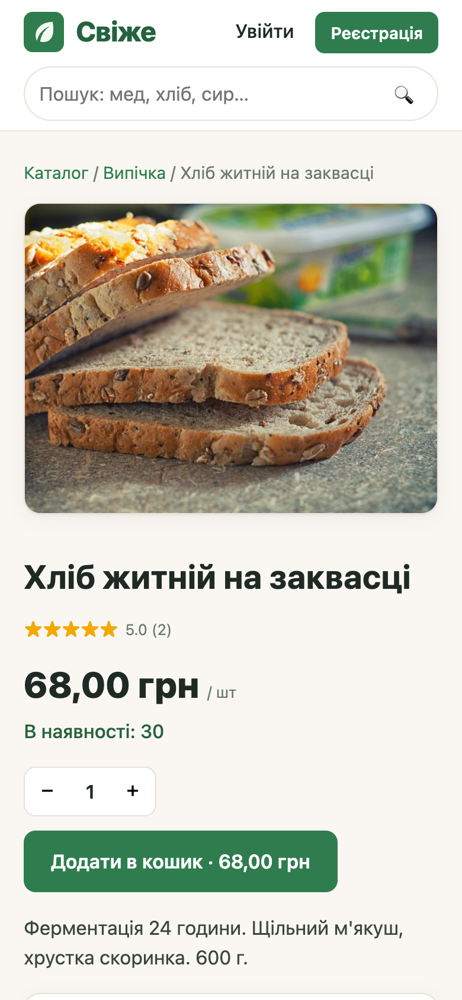

---

## Продавець

### Як почати продавати

1. Натисніть **«Реєстрація»** і оберіть **«Я продавець»**.
2. Окрім особистих даних вкажіть назву магазину, місто та короткий опис.

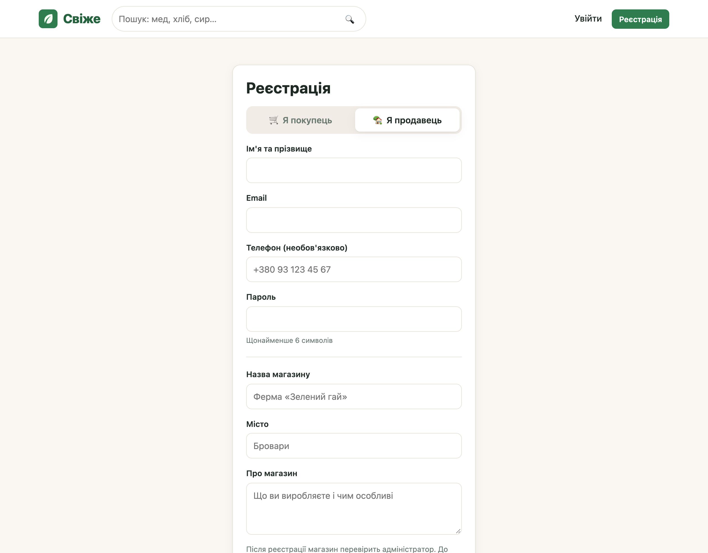

3. Після реєстрації магазин отримує статус **«очікує на перевірку»**. Ви вже можете додавати товари, але в каталозі вони з'являться після схвалення адміністратором.

### Кабінет продавця

Угорі — зведення: нові замовлення, усього замовлень, кількість товарів, виручка з доставлених замовлень.
Нижче три вкладки: **Замовлення**, **Товари**, **Профіль магазину**.

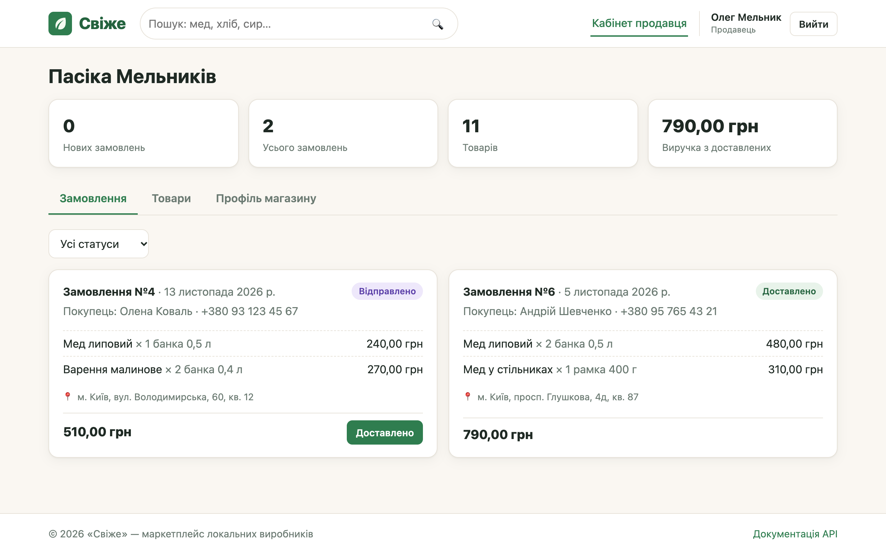

### Обробка замовлень

Кожне замовлення проходить ланцюжок, і на картці завжди є кнопка наступного кроку:

```
Нове ──«Підтвердити»──► Підтверджено ──«Відправлено»──► Відправлено ──«Доставлено»──► Доставлено
```

- **«Скасувати»** доступна для нових і підтверджених замовлень. Товари автоматично повертаються на склад.
- Відправлене замовлення скасувати вже не можна.
- У картці є ім'я, телефон та адреса покупця — зателефонуйте, щоб узгодити доставку.
- Фільтр над списком показує замовлення лише з обраним статусом.

### Товари

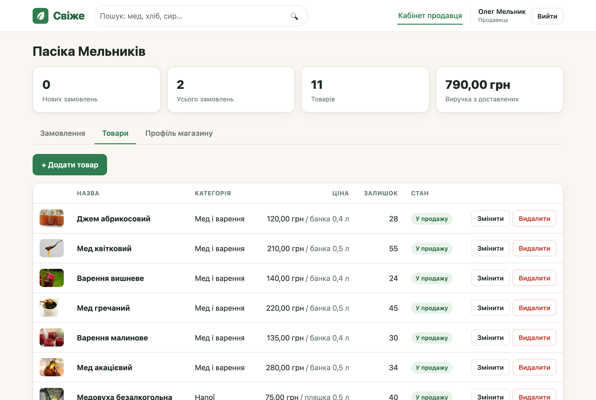

**Додати товар:** кнопка **«+ Додати товар»**.

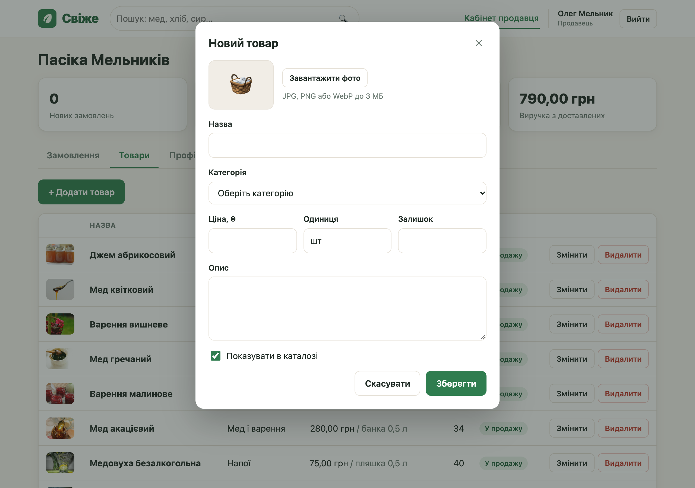

| Поле | Пояснення |
|---|---|
| Фото | JPG, PNG або WebP до 3 МБ. Без фото товар показується із заглушкою. |
| Назва | від 2 до 160 символів |
| Категорія | оберіть зі списку; якщо потрібної немає — попросіть адміністратора додати |
| Ціна | за одну одиницю, у гривнях |
| Одиниця | у чому продаєте: `кг`, `шт`, `банка 0,5 л` |
| Залишок | скільки одиниць є зараз; зменшується автоматично з кожним замовленням |
| Показувати в каталозі | зніміть позначку, щоб тимчасово сховати товар, не видаляючи |

**Змінити** — відкриває ту саму форму. Зміна ціни не впливає на вже оформлені замовлення: у них зберігається ціна на момент покупки.

**Видалити** — прибирає товар назавжди. В історії замовлень назва й ціна залишаться.

Коли залишок доходить до нуля, товар лишається в каталозі з позначкою «Немає в наявності» — просто оновіть залишок, коли з'явиться нова партія.

### Профіль магазину

Назву, місто й опис магазину бачать покупці на сторінці вашого магазину. Змінити їх можна у вкладці **«Профіль магазину»**.

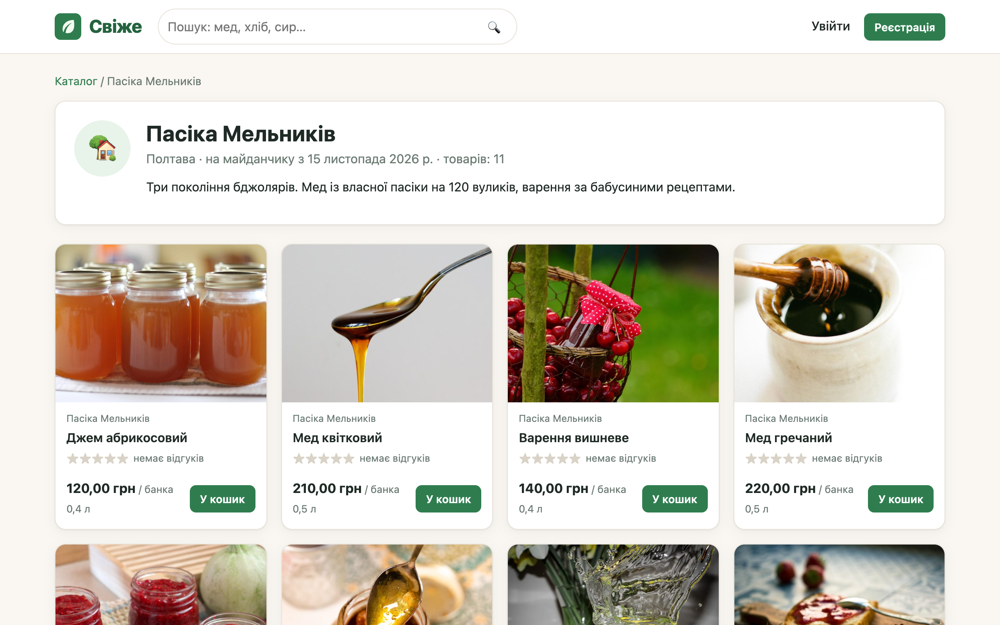

---

## Адміністратор майданчика

Після входу адміністратор потрапляє в **адмін-панель** з чотирма вкладками.

### Огляд

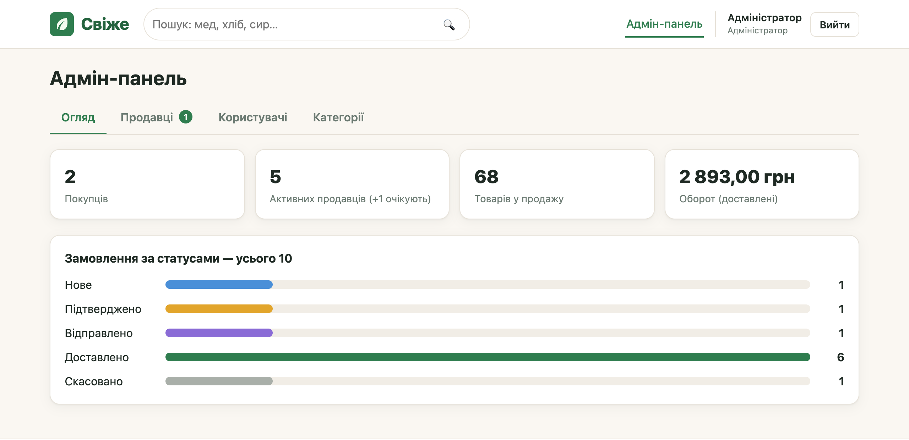

Кількість покупців, активних продавців, товарів у продажу, оборот за доставленими замовленнями та розподіл замовлень за статусами.

### Продавці

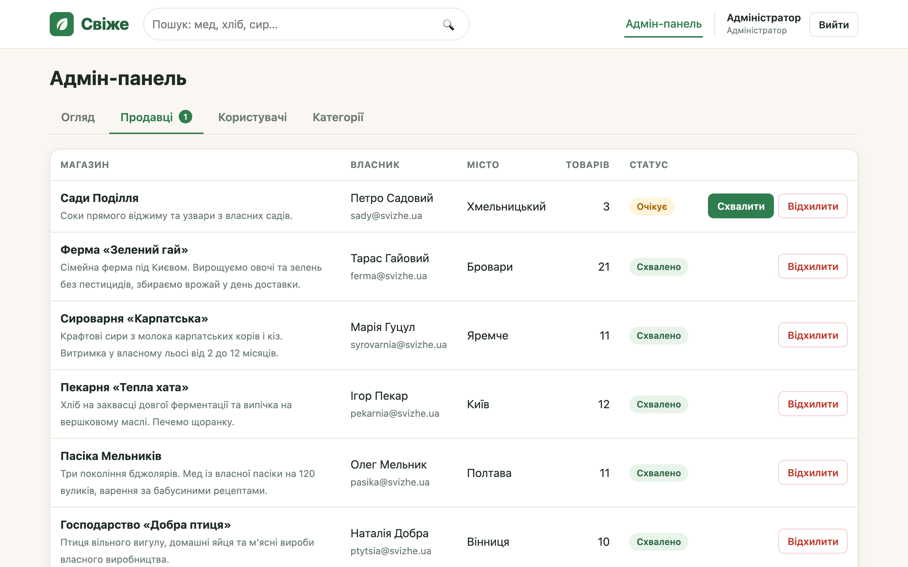

Нові заявки стоять на початку списку, а їх кількість видно на вкладці.

- **«Схвалити»** — товари магазину з'являються в каталозі.
- **«Відхилити»** — товари магазину зникають з каталогу. Рішення можна змінити будь-коли.

Перед схваленням перегляньте опис магазину та зв'яжіться з власником за вказаним email чи телефоном.

### Користувачі

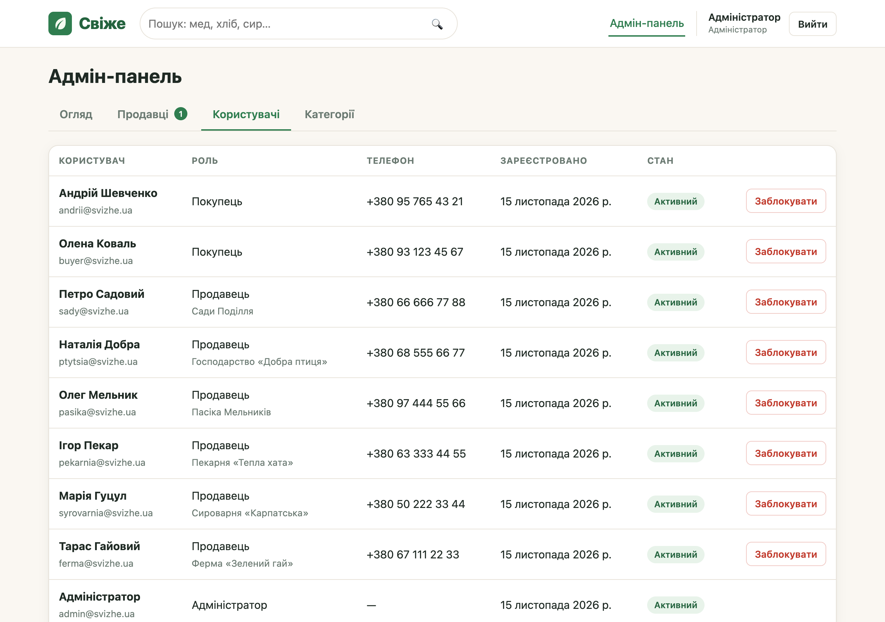

**«Заблокувати»** одразу позбавляє користувача доступу: він не зможе ні увійти, ні продовжити роботу у вже відкритій вкладці. Товари заблокованого продавця зникають з каталогу. **«Розблокувати»** повертає все назад. Власний акаунт заблокувати не можна.

### Категорії

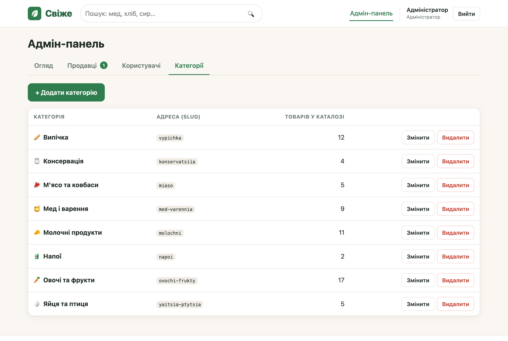

- **Назва** — те, що бачать покупці.
- **Адреса (slug)** — латинські літери, цифри, дефіс; використовується в посиланні на категорію.
- **Іконка** — емодзі поруч із назвою.

Категорію, в якій є товари, видалити не можна — спершу продавці мають перенести товари в іншу.

---

## Часті запитання

**Забув пароль.** Зверніться до адміністратора системи — він встановить новий (див. [посібник адміністратора системи](ADMIN_GUIDE.md#типові-операції)).

**Чому мого товару немає в каталозі?** Перевірте три речі: магазин схвалено адміністратором; у товару стоїть позначка «Показувати в каталозі»; акаунт не заблоковано.

**Чи може продавець купувати?** Акаунт продавця призначений лише для продажу. Для покупок зареєструйте окремий акаунт покупця з іншим email.

**Чому замовлення розділилося на кілька?** У кошику були товари різних продавців — кожен доставляє своє замовлення окремо.
