::: {custom-style="TitleCenter"}
КИЇВСЬКИЙ НАЦІОНАЛЬНИЙ УНІВЕРСИТЕТ\
ІМЕНІ ТАРАСА ШЕВЧЕНКА

Факультет комп'ютерних наук та кібернетики
:::

::: {custom-style="TitleCenter"}
\
\
\
\
\
:::

::: {custom-style="TitleBig"}
ЗВІТ
:::

::: {custom-style="TitleSub"}
про виконання групового програмного проєкту

**«Свіже» — маркетплейс локальних продуктів**
:::

::: {custom-style="TitleCenter"}
\
\
\
\
:::

::: {custom-style="TitleRight"}
Виконали:

студентка групи ІПС-41\
Макаренко Марина Володимирівна

студентка групи ІПС-42\
Полежай Іванна Олександрівна
:::

::: {custom-style="TitleCenter"}
\
\
\
\
\
\
Київ — 2026
:::

<!-- TOC -->

# ВСТУП

Невеликі виробники продуктів — фермери, сироварні, пекарні, пасіки — зазвичай продають через соцмережі та месенджери. Покупець у такому разі шукає кожного продавця окремо, а продавець веде замовлення вручну і не має спільної вітрини з іншими.

Мета проєкту — створити маркетплейс «Свіже»: один сайт, де покупець бачить товари багатьох виробників, збирає спільний кошик і оформлює замовлення, а кожен продавець отримує власний кабінет для товарів і замовлень.

За умовою завдання продукт складається з трьох частин — інтерфейсу, бази даних і системної частини — та супроводжується документацією, достатньою, щоб розгорнути й підтримувати систему без участі авторів. Кожній частині присвячено окремий розділ звіту: інтерфейсу — розділ 3, базі даних — розділ 4, системній частині — розділ 5.

Розподіл роботи в команді:

| Учасниця | Зона відповідальності |
|------|------------------|
| Макаренко М. В. | системна частина (REST API, авторизація, логіка замовлень), схема бази даних і міграції, розгортання в Docker, тести API, посібник адміністратора системи |
| Полежай І. О. | інтерфейс (сторінки покупця, продавця, адміністратора, адаптивна верстка), демонстраційні дані, ER-діаграма, посібник користувача, презентація |

Результат роботи: працюючий застосунок, який запускається однією командою; 39 автоматичних тестів; п'ять документів для різних читачів; вихідний код у спільному репозиторії.

# 1. ПОСТАНОВКА ЗАДАЧІ

## 1.1. Ролі користувачів

У системі три ролі. Гість (без входу) може лише переглядати каталог.

| Роль | Можливості |
|------|------------------|
| Покупець | пошук і фільтрація каталогу; перегляд товару та відгуків; кошик; оформлення замовлення; історія замовлень; скасування нового замовлення; відгук на отриманий товар |
| Продавець | профіль магазину; додавання, редагування, приховування та видалення товарів із фото; перегляд замовлень свого магазину; зміна статусу замовлення; зведення по виручці |
| Адміністратор | схвалення та відхилення продавців; блокування користувачів; керування категоріями; статистика майданчика |

## 1.2. Функціональні вимоги

1. Реєстрація та вхід за email і паролем; паролі зберігаються лише як хеші.
2. Каталог із пошуком за назвою, фільтрами за категорією та наявністю, сортуванням і посторінковим виводом.
3. Кошик, який зберігається на сервері й доступний з будь-якого пристрою.
4. Оформлення замовлення: кошик із товарами кількох продавців ділиться на окремі замовлення — по одному на продавця.
5. Залишок товару не може стати від'ємним навіть при одночасних замовленнях.
6. Замовлення проходить статуси «нове → підтверджено → відправлено → доставлено» або скасовується; під час скасування товар повертається на склад.
7. Новий продавець з'являється в каталозі лише після схвалення адміністратором.
8. Відгук може залишити лише покупець, якому товар доставлено.

## 1.3. Нефункціональні вимоги

1. **Самостійність.** Система запускається однією командою на комп'ютері, де є лише Docker; схема бази створюється автоматично.
2. **Супровід без авторів.** Є інструкції зі встановлення, резервного копіювання, відновлення та усунення типових несправностей.
3. **Безпека.** Доступ до кожної дії перевіряється на сервері; продавець не бачить чужих даних; база недоступна з мережі.
4. **Адаптивність.** Інтерфейс працює на екранах від 360 пікселів завширшки.

## 1.4. Чому маркетплейс

Розглянуто три способи організувати онлайн-продаж для малих виробників.

| Модель | Перевага | Недолік для нашої задачі |
|------------------|------------------|------------------------------|
| Власний інтернет-магазин кожного виробника | повний контроль над вітриною | кожному потрібен свій сайт і свої покупці; покупець не може зібрати спільний кошик |
| Дошка оголошень | просто додати товар | немає кошика, залишків і статусів замовлення; усе узгоджується в листуванні |
| Маркетплейс | спільна вітрина й потік покупців; єдиний процес замовлення | потрібна модерація продавців і поділ замовлення між ними |

Обрано маркетплейс. Обидва його недоліки закрито функціями системи: модерацію виконує адміністратор (вимога 7), поділ замовлення — системна частина (вимога 4).

# 2. АРХІТЕКТУРА СИСТЕМИ

## 2.1. Три частини

Продукт побудовано за класичною трирівневою схемою. Кожна частина працює в окремому контейнері Docker (рис. 2.1).

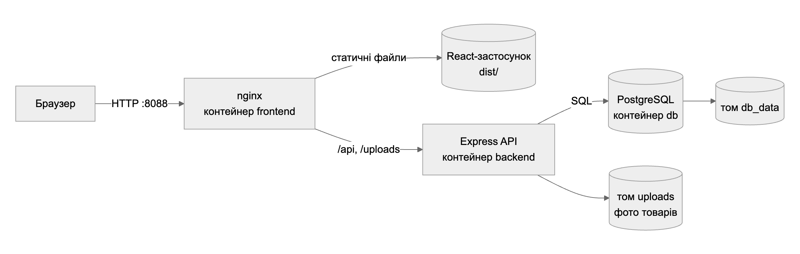{width=100%}

Назовні відкрито один порт — веб-сервер nginx. Він віддає файли інтерфейсу і передає запити, що починаються з `/api` та `/uploads`, системній частині. База даних доступна лише системній частині всередині внутрішньої мережі Docker.

## 2.2. Технології та причини вибору

| Частина | Технологія | Чому |
|------------|------------------|------------------------------------|
| Інтерфейс | React 19, React Router 7, Vite | компонентний підхід: картка товару чи замовлення описується один раз і використовується на кількох сторінках |
| Системна частина | Node.js 22, Express 5 | та сама мова, що й в інтерфейсі, — уся команда читає весь код |
| База даних | PostgreSQL 16 | транзакції та блокування рядків, без яких неможливо гарантувати вимогу 5; обмеження `CHECK` |
| Авторизація | JWT, bcrypt | сервер не зберігає сесій; паролі не зберігаються у відкритому вигляді |
| Розгортання | Docker Compose, nginx | однакове середовище на будь-якому комп'ютері; запуск однією командою |

## 2.3. Структура репозиторію

```
backend/              системна частина
  src/                маршрути, авторизація, логіка замовлень, міграції
  test/               інтеграційні тести
  openapi.yaml        опис API
frontend/             інтерфейс
  src/                сторінки, компоненти, стилі
db/migrations/        SQL-міграції схеми бази
scripts/              резервне копіювання та відновлення
docs/                 документація
docker-compose.yml    запуск усіх трьох частин
```

Обсяг коду: системна частина — 1393 рядки, тести — 487, інтерфейс — 1938, SQL-міграції — 142.

# 3. ІНТЕРФЕЙС

## 3.1. Сторінки та навігація

Інтерфейс — односторінковий застосунок: після першого завантаження переходи між сторінками відбуваються без перезавантаження, дані підвантажуються запитами до API.

| Адреса | Сторінка | Доступ |
|------------------------|------------------------------|------------------|
| `/` | каталог | усі |
| `/product/:id` | товар і відгуки | усі |
| `/shop/:id` | магазин продавця | усі |
| `/login`, `/register` | вхід і реєстрація | гості |
| `/cart`, `/checkout`, `/orders` | кошик, оформлення, замовлення | покупець |
| `/seller` | кабінет продавця (замовлення, товари, профіль) | продавець |
| `/admin` | адмін-панель (огляд, продавці, користувачі, категорії) | адміністратор |

Сторінки з обмеженим доступом загорнуті в компонент `Only`: гостя він перенаправляє на вхід, користувача з іншою роллю — на головну. Це лише зручність: справжня перевірка прав відбувається в системній частині (розділ 5.2).

## 3.2. Каталог

Головна сторінка (рис. 3.1) містить пошук, перелік категорій з кількістю товарів, сортування та сітку карток. Товар, що закінчився, залишається в каталозі з позначкою «Немає в наявності».

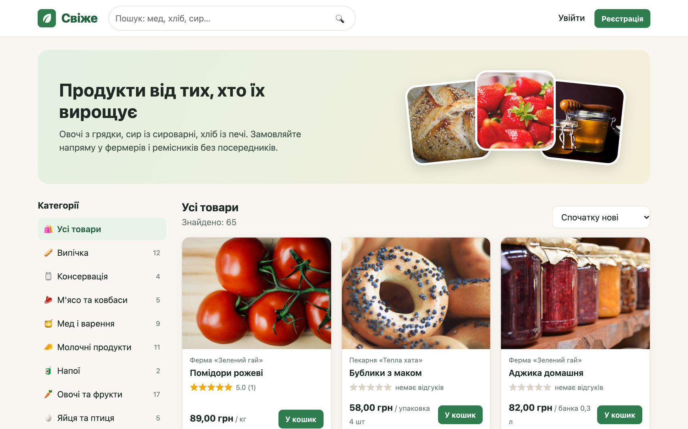{width=100%}

Стан фільтрів зберігається в адресі сторінки, наприклад `/?category=molochni&sort=price_asc` (рис. 3.2). Завдяки цьому працює кнопка «Назад» у браузері, а посиланням на результат пошуку можна поділитися.

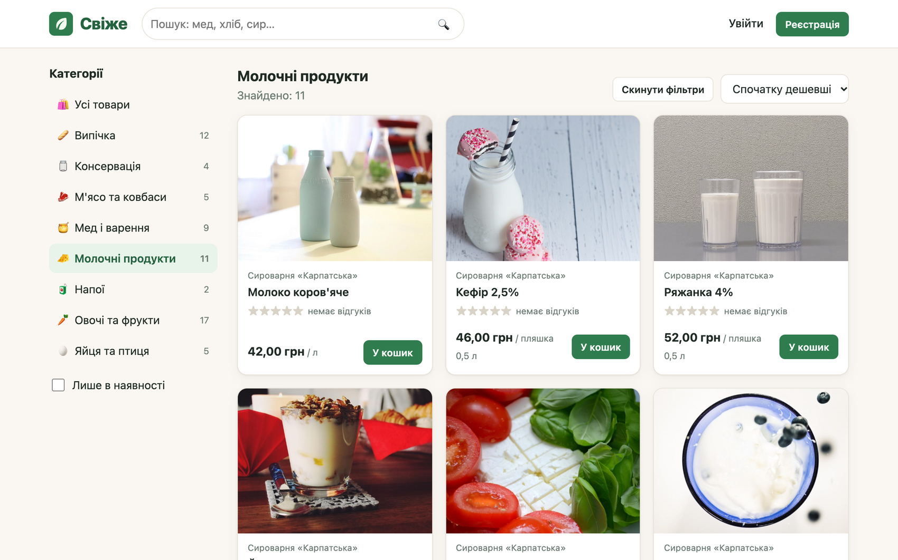{width=100%}

## 3.3. Товар, кошик і оформлення

На сторінці товару (рис. 3.3) покупець бачить ціну, залишок, опис, продавця й відгуки та обирає кількість. Кнопка додавання одразу показує суму.

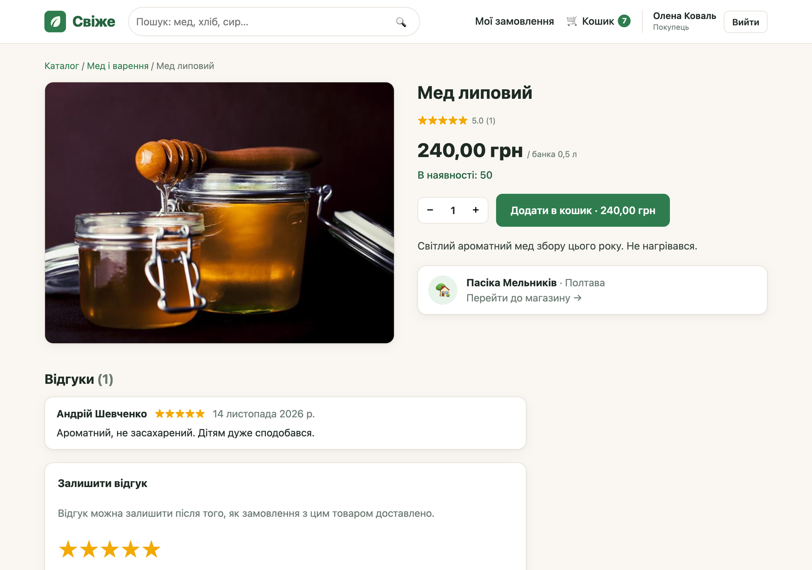{width=100%}

У кошику (рис. 3.4) товари згруповано за продавцями, а в підсумку прямо сказано, на скільки замовлень буде поділено кошик. Якщо товару на складі стало менше, ніж у кошику, позиція позначається, і кнопка оформлення блокується до виправлення.

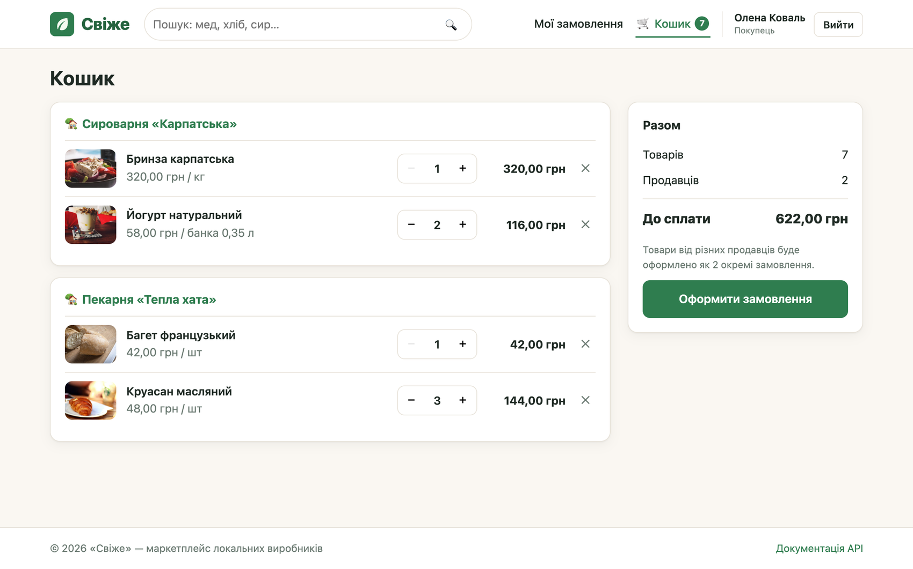{width=100%}

Форма оформлення (рис. 3.5) запитує лише адресу, телефон і необов'язковий коментар. Телефон підставляється з профілю.

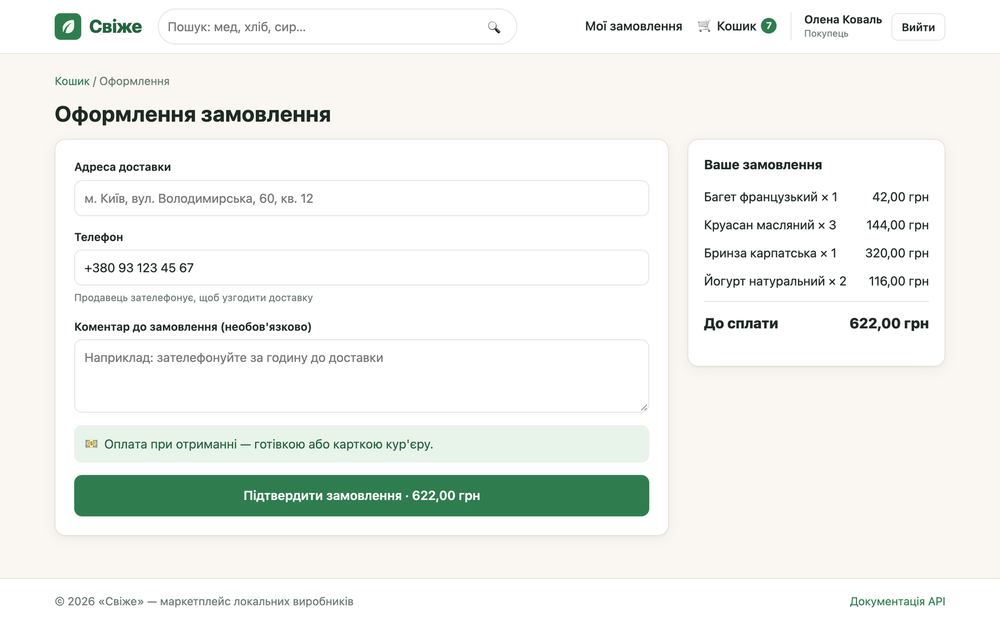{width=100%}

Після оформлення покупець потрапляє на сторінку своїх замовлень (рис. 3.6). Статус показано кольоровою позначкою; для нового замовлення доступне скасування, для доставленого — перехід до відгуку.

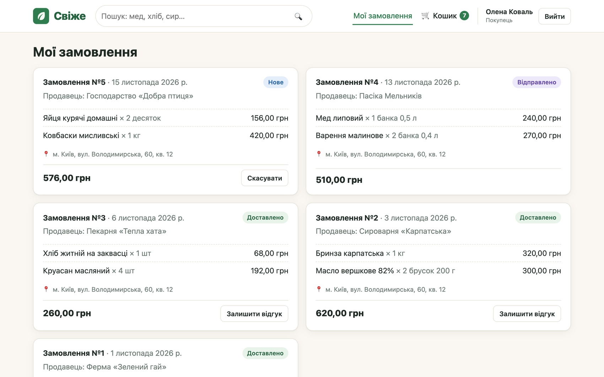{width=100%}

## 3.4. Кабінет продавця

Угорі кабінету — чотири показники: нові замовлення, усі замовлення, кількість товарів, виручка з доставлених (рис. 3.7). На картці замовлення завжди одна основна кнопка — наступний крок у ланцюжку статусів, тому продавцю не потрібно пам'ятати порядок.

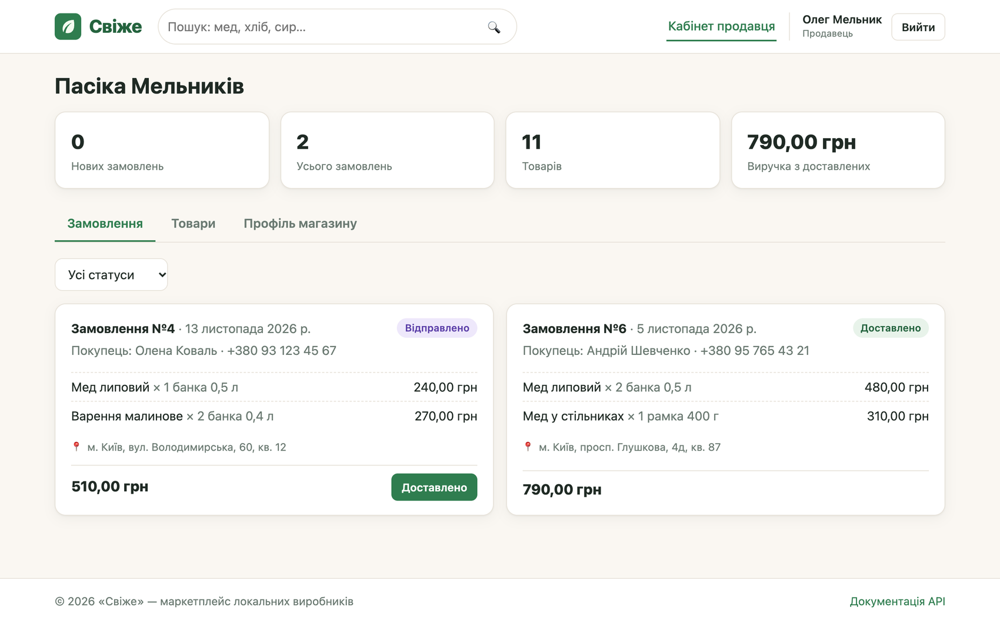{width=100%}

Товари показано таблицею (рис. 3.8); додавання і редагування відбуваються в одній формі (рис. 3.9). Фото завантажується одразу після вибору файлу, і продавець бачить його ще до збереження.

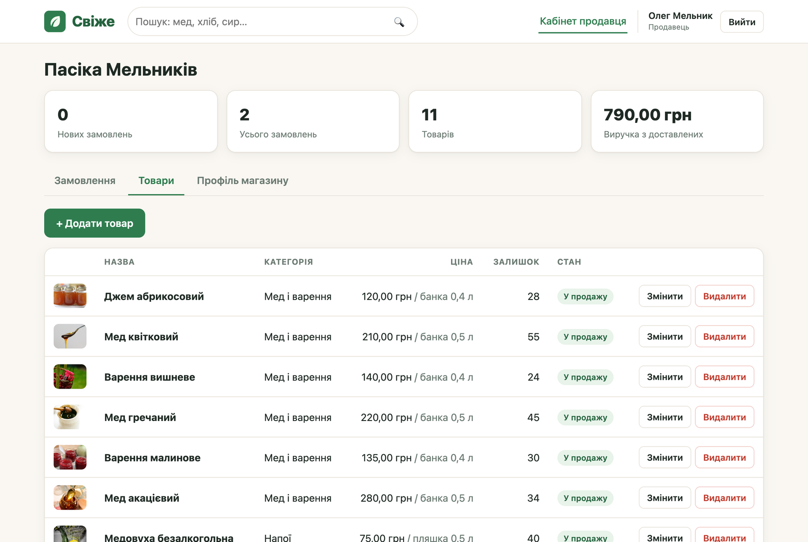{width=100%}

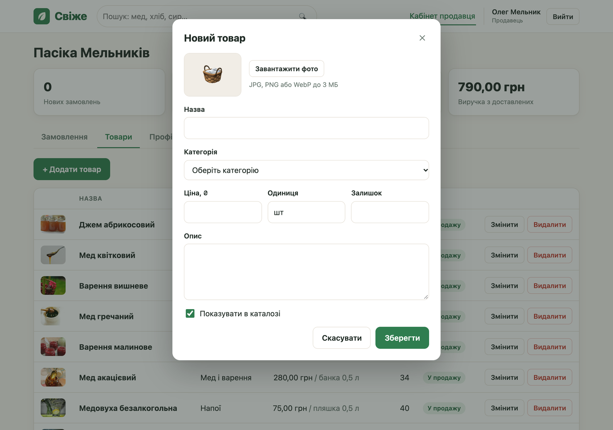{width=75%}

## 3.5. Адмін-панель

Вкладка «Огляд» (рис. 3.10) показує основні числа майданчика та розподіл замовлень за статусами. На вкладці «Продавці» (рис. 3.11) нові заявки стоять першими, а їх кількість видно на самій вкладці.

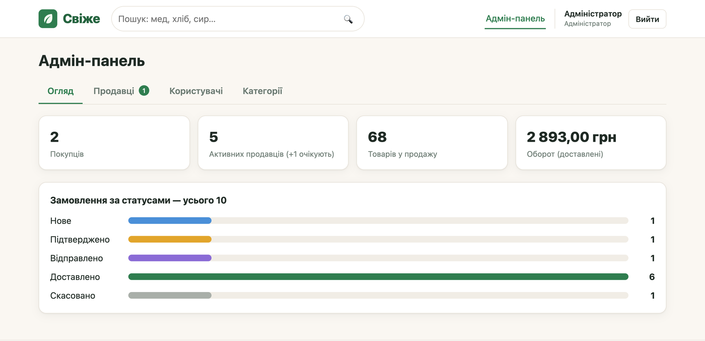{width=100%}

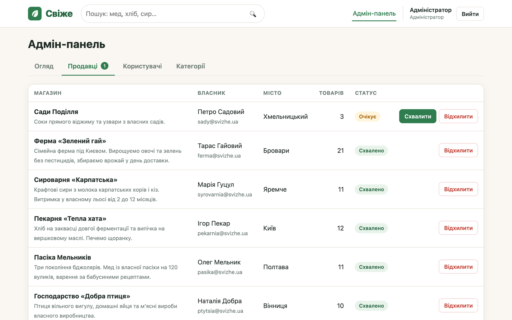{width=100%}

## 3.6. Адаптивність

Верстка побудована на CSS Grid і перебудовується на двох порогах ширини — 900 і 600 пікселів. На телефоні (рис. 3.12) бічна панель категорій стає горизонтальною стрічкою, сітка товарів — двоколонковою, а таблиці кабінетів прокручуються горизонтально в межах своєї картки.

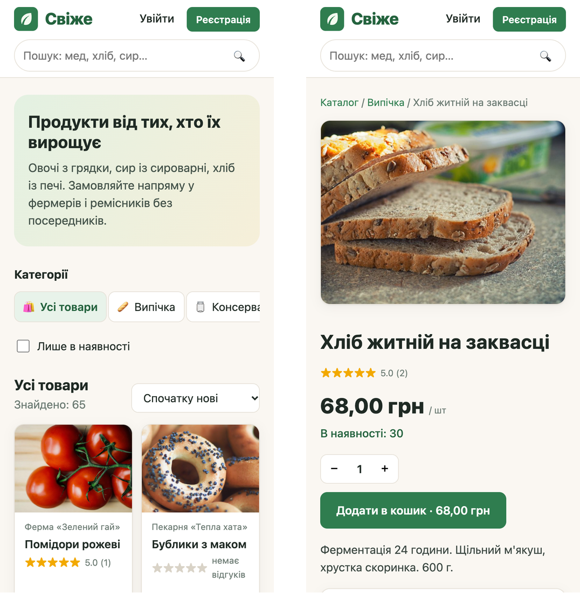{width=75%}

## 3.7. Стани та помилки

Кожна сторінка, що завантажує дані, має три стани: завантаження (індикатор), помилка (текст і кнопка «Спробувати ще раз») та порожній результат (пояснення, що робити далі). Текст помилки приходить від системної частини українською мовою і показується без змін, тому користувач бачить конкретну причину: «На складі лише 3», а не «Помилка 409».

# 4. БАЗА ДАНИХ

## 4.1. Схема

База містить вісім таблиць (рис. 4.1).

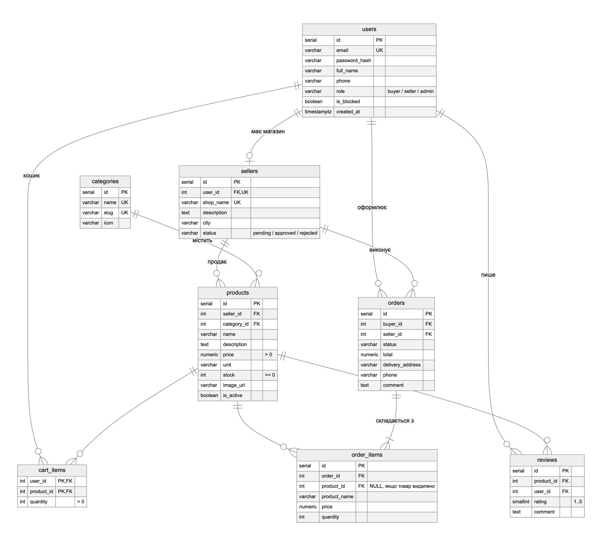{width=86%}

| Таблиця | Призначення |
|------|------------------|
| `users` | усі користувачі; роль і ознака блокування |
| `sellers` | магазин продавця; зв'язок «один до одного» з `users`; статус модерації |
| `categories` | категорії товарів |
| `products` | товари: ціна, одиниця виміру, залишок, фото, ознака активності |
| `cart_items` | вміст кошиків; складений первинний ключ (користувач, товар) |
| `orders` | замовлення: покупець, продавець, статус, сума, адреса |
| `order_items` | позиції замовлення |
| `reviews` | відгуки; не більше одного на пару (товар, користувач) |

## 4.2. Цілісність даних

Правила, від яких залежить коректність, записані в самій базі, а не лише в коді застосунку. Якщо в системній частині з'явиться помилка, база все одно відхилить некоректний запис.

| Правило | Як забезпечено |
|------|------|
| ціна додатна, залишок невід'ємний | `CHECK (price > 0)`, `CHECK (stock >= 0)` |
| оцінка від 1 до 5 | `CHECK (rating BETWEEN 1 AND 5)` |
| роль і статуси — лише з переліку | `CHECK (role IN (...))`, `CHECK (status IN (...))` |
| один email — один акаунт | `UNIQUE (email)` |
| один відгук на товар від користувача | `UNIQUE (product_id, user_id)` |
| категорію з товарами не можна видалити | зовнішній ключ `ON DELETE RESTRICT` |
| видалення користувача прибирає його кошик | зовнішній ключ `ON DELETE CASCADE` |

Обмеження `CHECK (stock >= 0)` — друга лінія захисту вимоги 5: навіть якби блокування в коді не спрацювало, транзакція, що робить залишок від'ємним, була б відхилена.

## 4.3. Незмінність історії замовлень

У таблиці `order_items` назва, одиниця та ціна товару зберігаються копією, а не лише посиланням на `products`:

```sql
CREATE TABLE order_items (
    id           SERIAL PRIMARY KEY,
    order_id     INTEGER NOT NULL REFERENCES orders (id) ON DELETE CASCADE,
    product_id   INTEGER REFERENCES products (id) ON DELETE SET NULL,
    product_name VARCHAR(160)   NOT NULL,
    unit         VARCHAR(20)    NOT NULL DEFAULT 'шт',
    price        NUMERIC(10, 2) NOT NULL CHECK (price > 0),
    quantity     INTEGER        NOT NULL CHECK (quantity > 0)
);
```

Коли продавець змінює ціну або видаляє товар, старі замовлення не змінюються: у позиції залишаються назва й ціна на момент покупки, а `product_id` стає `NULL`.

## 4.4. Подання каталогу

Товар видно покупцям, якщо одночасно виконуються три умови: товар активний, продавця схвалено, власника магазину не заблоковано. Щоб це правило не повторювалося в кожному запиті, його винесено в подання `catalog_products`, яке також додає назву категорії, назву магазину та середню оцінку:

```sql
CREATE VIEW catalog_products AS
SELECT p.id, p.name, p.price, p.unit, p.stock, ...,
       c.name AS category_name, s.shop_name,
       COALESCE(r.avg_rating, 0) AS rating
FROM products p
JOIN categories c ON c.id = p.category_id
JOIN sellers s    ON s.id = p.seller_id
JOIN users u      ON u.id = s.user_id
LEFT JOIN (SELECT product_id, AVG(rating) AS avg_rating, COUNT(*) AS reviews_count
           FROM reviews GROUP BY product_id) r ON r.product_id = p.id
WHERE p.is_active AND s.status = 'approved' AND NOT u.is_blocked;
```

Каталог, пошук, кошик і лічильники категорій читають лише з цього подання. Тому відхилення продавця або блокування користувача прибирає його товари звідусіль однією зміною одного поля.

## 4.5. Індекси

| Індекс | Який запит прискорює |
|------|------|
| `products (category_id) WHERE is_active` | фільтр каталогу за категорією |
| `products (lower(name))` | пошук за назвою без урахування регістру |
| `orders (buyer_id, created_at DESC)` | «Мої замовлення» |
| `orders (seller_id, created_at DESC)` | замовлення в кабінеті продавця |
| `order_items (order_id)`, `reviews (product_id)` | позиції замовлення, відгуки товару |

## 4.6. Міграції

Схема описана трьома SQL-файлами в каталозі `db/migrations`: таблиці, індекси, подання. Під час кожного запуску системна частина порівнює їх із таблицею `schema_migrations` і застосовує лише нові файли, кожен — в окремій транзакції. Тому розгортання на чистому сервері й оновлення працюючої системи виконуються однією й тією самою командою, без ручних дій із базою.

# 5. СИСТЕМНА ЧАСТИНА

## 5.1. REST API

Системна частина — HTTP-сервер, який приймає й повертає JSON. API налічує 37 операцій у семи групах.

| Група | Адреси | Операцій |
|------------------|------------------------------|------------|
| Система | `/api/health` | 1 |
| Акаунт | `/api/auth/...` | 4 |
| Каталог | `/api/products`, `/api/categories`, `/api/sellers` | 5 |
| Кошик | `/api/cart` | 5 |
| Замовлення | `/api/orders` | 4 |
| Кабінет продавця | `/api/seller/...` | 10 |
| Адміністрування | `/api/admin/...` | 8 |

Опис усіх операцій зберігається у файлі `openapi.yaml` і відкривається в працюючій системі за адресою `/api/docs` (рис. 5.1). Там же запит можна виконати прямо з браузера.

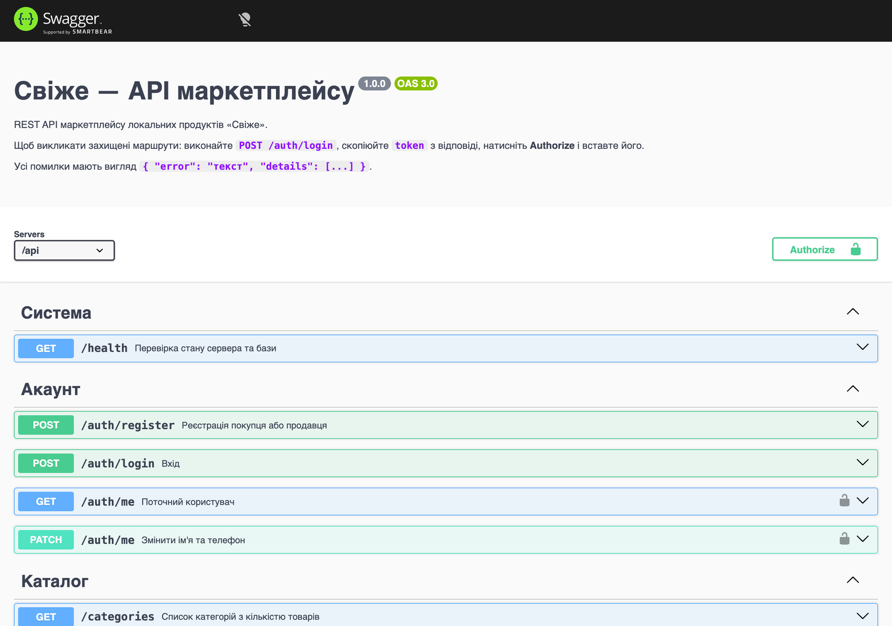{width=100%}

## 5.2. Авторизація та розмежування доступу

Під час входу пароль порівнюється з bcrypt-хешем із бази. Якщо збігається, сервер видає токен JWT з ідентифікатором користувача, підписаний секретом зі змінної оточення. Інтерфейс додає токен до кожного запиту.

На кожен захищений запит сервер перевіряє підпис токена і читає користувача з бази. Роль і ознака блокування беруться з бази, а не з токена, тому блокування діє негайно, а не після завершення терміну дії токена.

Доступ обмежено на двох рівнях:

1. **За роллю.** Кожна група маршрутів закрита перевіркою: `/api/seller/...` — лише продавець, `/api/admin/...` — лише адміністратор, кошик і замовлення — лише покупець.
2. **За власником.** Кожен запит продавця містить умову `seller_id = <магазин поточного користувача>`. Спроба змінити чужий товар або замовлення повертає «не знайдено» — так само, як для неіснуючого запису.

## 5.3. Оформлення замовлення

Це головна операція системи. Вона виконується однією транзакцією (рис. 5.2).

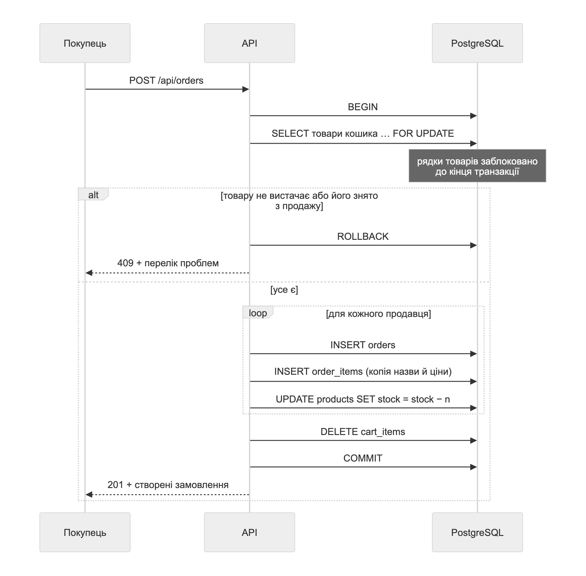{width=85%}

Ключовий момент — блокування рядків товарів:

```sql
SELECT ci.product_id, ci.quantity, p.name, p.price, p.stock, p.seller_id, ...
FROM cart_items ci
JOIN products p ON p.id = ci.product_id
JOIN sellers s  ON s.id = p.seller_id
WHERE ci.user_id = $1
ORDER BY p.id
FOR UPDATE OF p
```

`FOR UPDATE` не дає іншій транзакції змінити ці товари, доки поточна не завершиться. Якщо двоє покупців одночасно оформлюють останню одиницю товару, другий запит чекає на перший, бачить залишок 0 і отримує відмову з поясненням. Сортування `ORDER BY p.id` гарантує, що всі транзакції блокують товари в однаковому порядку, — це виключає взаємне блокування.

Далі системна частина групує позиції за продавцями і для кожного створює окреме замовлення, копіює позиції в `order_items`, зменшує залишки й очищує кошик. Якщо будь-який крок завершується помилкою, уся транзакція відкочується: не буває замовлення без списаного залишку чи списаного залишку без замовлення.

## 5.4. Статуси замовлення

Дозволені переходи статусу задано таблицею (рис. 5.3):

```js
export const TRANSITIONS = {
  new: ['confirmed', 'cancelled'],
  confirmed: ['shipped', 'cancelled'],
  shipped: ['delivered'],
  delivered: [],
  cancelled: [],
};
```

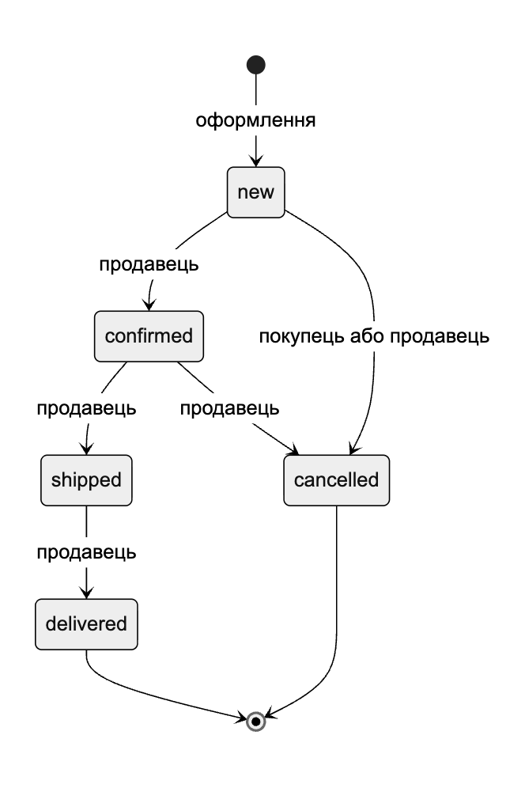{width=40%}

Будь-який інший перехід сервер відхиляє. Покупець може виконати лише один перехід — скасувати власне нове замовлення. Під час скасування залишки повертаються на склад у тій самій транзакції, що й зміна статусу.

## 5.5. Перевірка даних і помилки

Вхідні дані кожного запиту перевіряються до звернення до бази: типи, довжина рядків, діапазони чисел, формат email і телефону. Усі помилки повертаються в одному форматі — `{"error": "текст", "details": [...]}` — з відповідним кодом.

| Код | Значення | Приклад |
|------|------------------|------------------------------------|
| 400 | некоректні дані | ціна не є додатним числом |
| 401 | не виконано вхід | немає токена або він недійсний |
| 403 | немає прав | покупець звертається до адмін-панелі; акаунт заблоковано |
| 404 | не знайдено | товар не існує або належить іншому продавцю |
| 409 | конфлікт стану | email уже зайнятий; товару не вистачає; заборонений перехід статусу |
| 500 | внутрішня помилка | подробиці пишуться лише в журнал сервера |

## 5.6. Розгортання

Файл `docker-compose.yml` описує три сервіси й порядок їх запуску: системна частина стартує лише після того, як база пройде перевірку готовності, інтерфейс — після системної частини. Під час старту системна частина сама застосовує міграції та, якщо база порожня, додає демонстраційні дані.

```bash
cp .env.example .env
docker compose up -d --build
```

Усі налаштування — пароль бази, секрет токенів, порт сайту — винесено у файл `.env`. Дані зберігаються у двох томах Docker (база та фото товарів) і не зникають під час оновлення чи перезапуску контейнерів. Контейнери мають політику перезапуску `unless-stopped`, тому після перезавантаження сервера сайт піднімається без втручання.

## 5.7. Експлуатація

Засоби, які дозволяють підтримувати систему без авторів:

1. **Перевірка стану.** Адреса `/api/health` відповідає успіхом лише тоді, коли є зв'язок із базою. Її використовує Docker для перевірки контейнера, і її можна під'єднати до зовнішнього монітора.
2. **Журнал.** Кожен запит записується одним рядком: час, метод, адреса, код відповіді, тривалість. Внутрішні помилки позначаються словом «ПОМИЛКА» разом із текстом.
3. **Резервне копіювання.** Скрипт `scripts/backup.sh` зберігає базу й фото в каталог із датою, не зупиняючи сайт. Скрипт `scripts/restore.sh` відновлює систему з такої копії.
4. **Коректне завершення.** Отримавши сигнал зупинки, сервер дочікується завершення активних запитів і закриває з'єднання з базою.

# 6. ТЕСТУВАННЯ

## 6.1. Автоматичні тести API

Написано 39 інтеграційних тестів. Вони звертаються до справжнього сервера по HTTP і працюють зі справжньою PostgreSQL: перед прогоном створюється окрема тестова база, після — видаляється. Робочі дані тести не зачіпають.

| Група | Тестів | Що перевіряється |
|------------------|------------|------------------------------------------|
| Акаунт | 7 | реєстрація, вхід, повторний email, слабкий пароль, зберігання пароля хешем, доступ без токена |
| Ролі та модерація | 4 | статус нового продавця; недоступність чужих розділів; товар видно лише після схвалення |
| Товари продавця | 3 | відхилення некоректних даних; захист чужих товарів; приховування |
| Каталог | 4 | пошук без урахування регістру; фільтри; сортування й сторінки; лічильники категорій |
| Кошик | 4 | підсумовування кількості; обмеження залишком; незалежність кошиків |
| Замовлення | 9 | поділ за продавцями; списання залишку; одночасна покупка останньої одиниці; ланцюжок статусів; повернення на склад; незмінність історії |
| Відгуки | 2 | відгук лише після доставки; вплив на рейтинг; заборона повторного |
| Адміністрування | 5 | категорії; відхилення продавця; негайна дія блокування; статистика |
| Обробка помилок | 1 | невідомий маршрут; пошкоджений JSON |

Запуск: `docker compose exec backend npm test`. Результат останнього прогону: 39 пройдено, 0 не пройдено, тривалість 1–3 секунди.

Найважливіший тест — на одночасність. Два покупці кладуть у кошик товар із залишком 1 і одночасно надсилають запит на оформлення. Тест перевіряє, що рівно один запит завершується успіхом (код 201), другий отримує відмову (код 409), а залишок дорівнює нулю.

```{=openxml}
<w:p><w:r><w:br w:type="page"/></w:r></w:p>
```

## 6.2. Перевірка інтерфейсу

Основні сценарії пройдено вручну в браузері на працюючій системі.

| Сценарій | Результат |
|------|------|
| вхід покупця → два товари різних продавців у кошик → оформлення | створено два замовлення; кошик очищено; залишки зменшено |
| вхід продавця → нове замовлення видно в кабінеті → «Підтвердити» | статус змінено; лічильник нових замовлень зменшився |
| вхід адміністратора → огляд, продавці, категорії | дані відповідають базі; заявка нового продавця стоїть першою |
| ширина екрана 375 пікселів, каталог і адмін-панель | горизонтального прокручування сторінки немає |

Під час перевірки на вузькому екрані знайдено й виправлено дефект: стрічка категорій розтягувала сторінку за межі екрана. Причина — мінімальна ширина колонки сітки; виправлено заміною `1fr` на `minmax(0, 1fr)`.

## 6.3. Перевірка резервного копіювання

Скрипти перевірено на практиці: створено копію, з бази навмисно видалено всі замовлення, відгуки та 63 із 68 товарів, а також 30 із 68 фото; виконано відновлення. Після відновлення в базі знову 10 замовлень, 68 товарів, 12 відгуків і всі фото; сайт відповідає.

# 7. ДОКУМЕНТАЦІЯ

Документація лежить у репозиторії поруч із кодом і поділена за читачами: кожен відкриває один документ і не шукає потрібне серед чужого.

| Документ | Читач | Зміст |
|------------------|------------------------|------------------------------------|
| `README.md` | будь-хто | що це, запуск за п'ять рядків, демо-акаунти, перелік документів |
| `docs/INSTALL.md` | той, хто розгортає | вимоги, налаштування `.env`, запуск, перевірка, запуск без демо-даних |
| `docs/USER_GUIDE.md` | покупець, продавець, адміністратор майданчика | покрокові сценарії зі знімками екрана для кожної ролі; часті запитання |
| `docs/ADMIN_GUIDE.md` | той, хто підтримує сервер | контроль стану, журнали, резервні копії, оновлення, перенесення, таблиця несправностей |
| `docs/ARCHITECTURE.md` | розробник | призначення кожного файлу, логіка замовлень, схема бази, як додати міграцію |
| `/api/docs` | розробник | інтерактивний довідник усіх операцій API |

Команди з інструкцій перевірено виконанням на працюючій системі: запуск, перевірка стану, резервна копія й відновлення, скидання пароля, запуск тестів.

# ВИСНОВКИ

Створено маркетплейс локальних продуктів «Свіже», що складається з трьох частин.

**Інтерфейс** охоплює всі сценарії трьох ролей — від пошуку товару до модерації продавців — і працює на екранах від телефона до монітора.

**База даних** із восьми таблиць зберігає правила цілісності у вигляді обмежень, а правило видимості товару — в одному поданні. Схема розгортається й оновлюється автоматично.

**Системна частина** надає 37 операцій API, перевіряє права на кожну дію і гарантує коректність залишків при одночасних замовленнях за допомогою транзакцій та блокування рядків.

Вимогу самостійності продукту виконано: система запускається однією командою, має перевірку стану, журнал, перевірені скрипти резервного копіювання й відновлення та документацію для кожного типу читача. Коректність підтверджено 39 автоматичними тестами.

Напрями розвитку: онлайн-оплата; сповіщення продавцю про нове замовлення електронною поштою; розрахунок вартості доставки; відновлення пароля самим користувачем.

# СПИСОК ВИКОРИСТАНИХ ДЖЕРЕЛ

1. PostgreSQL 16 Documentation. URL: https://www.postgresql.org/docs/16/
2. PostgreSQL 16 Documentation. Explicit Locking. URL: https://www.postgresql.org/docs/16/explicit-locking.html
3. Express 5.x API Reference. URL: https://expressjs.com/en/5x/api.html
4. React Documentation. URL: https://react.dev/
5. React Router Documentation. URL: https://reactrouter.com/
6. Docker Compose Documentation. URL: https://docs.docker.com/compose/
7. RFC 7519. JSON Web Token (JWT). URL: https://datatracker.ietf.org/doc/html/rfc7519
8. OpenAPI Specification 3.0.3. URL: https://spec.openapis.org/oas/v3.0.3
9. nginx Documentation. URL: https://nginx.org/en/docs/

# ДОДАТОК А. ДЕМОНСТРАЦІЙНІ АКАУНТИ

Після першого запуску база містить 6 магазинів, 68 товарів у 8 категоріях, 2 покупців, 10 замовлень у різних статусах і 12 відгуків. Фото товарів узято з відкритих джерел із вільними ліцензіями (CC0, CC BY, CC BY-SA); автори й посилання перелічені у файлі `backend/seed-images/CREDITS.md`. Пароль усіх демонстраційних акаунтів — `demo1234`.

| Роль | Email |
|------|------|
| Покупець | `buyer@svizhe.ua` |
| Покупець | `andrii@svizhe.ua` |
| Продавець (схвалений) | `pasika@svizhe.ua` |
| Продавець (очікує схвалення) | `sady@svizhe.ua` |
| Адміністратор | `admin@svizhe.ua` |

Сайт після запуску: `http://localhost:8088`. Довідник API: `http://localhost:8088/api/docs`.
